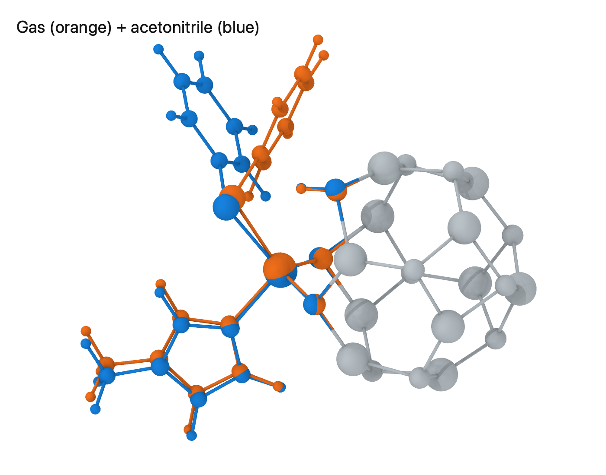

# State-2 ligand orientation and dispersion

```bash
python geometry/inspect_state2.py
```

The script aligns the gas and C-PCM state-2 coordinates using the same 20 frozen
cage atoms (one-based IDs 5–24). It writes `metrics.json` and the aligned PCM
coordinates. Source coordinates are shared with `cage/`; atom order is retained.

The phenyl planes differ by 57.96°, whereas the MeIm ring planes differ by
5.60°. Zn–S and Zn–N coordination remains present. Pairwise D3(BJ) decomposition
assigns +24.97 kJ mol⁻¹ of the PCM-minus-gas dispersion change to the
thiophenolate–oxide/hydroxyl group; the total state-2 change is +24.56 kJ mol⁻¹.
The script checks that the pair contributions sum to the total D3 energy and
that this total matches the independent Q-Chem PCM result.

These are two optimized endpoint geometries. The comparison does not establish
distinct conformational basins or their populations in solution.



Orange marks the gas mobile atoms; blue marks the PCM mobile atoms; shared
frozen atoms are gray. Rendering is optional and requires OVITO 3.17.2 and its
PySide6 dependencies:

```bash
python geometry/inspect_state2.py --render
```

Atom groups are explicit in the script. The oxide group includes atoms 1–24
and hydroxyl H37, thiophenolate includes 25–36, and MeIm includes 38–49.
